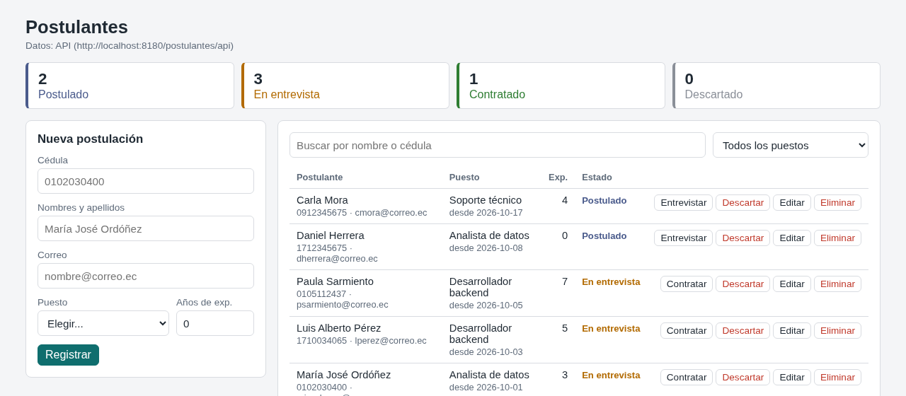

# jakarta-postulantes-api

[](https://github.com/Whiteherobot/jakarta-postulantes-api/actions/workflows/ci.yml)

API REST en Jakarta EE 10 (JAX-RS, CDI, JPA y JTA) para registrar
postulaciones a vacantes y seguir cada una hasta la contratación o el descarte.
Corre en WildFly 41. Su cliente es
[angular-postulantes](https://github.com/Whiteherobot/angular-postulantes).



## Endpoints

Base: `http://localhost:8080/postulantes/api`

| Método | Ruta | Qué hace |
|---|---|---|
| GET | `/postulantes?puesto=&estado=&q=` | Lista, la más reciente primero. `q` busca en nombre y cédula. |
| GET | `/postulantes/{id}` | Una postulación. |
| POST | `/postulantes` | Registra una postulación (estado `POSTULADO`, fecha de hoy). Responde 201 con `Location`. |
| PUT | `/postulantes/{id}` | Cambia los datos; no toca el estado ni la fecha. |
| PUT | `/postulantes/{id}/estado` | `{"estado": "ENTREVISTA"}`. Solo avanza de `POSTULADO` a `ENTREVISTA` y de ahí a `CONTRATADO` o `DESCARTADO`. |
| DELETE | `/postulantes/{id}` | Borra (204). |

```json
POST /postulantes
{"cedula": "0912345675", "nombres": "Carla Mora", "correo": "cmora@correo.ec",
 "puesto": "Soporte técnico", "experiencia": 4}
```

Errores, siempre en JSON:

- **400** `{"errores": {"cedula": "La cédula no es válida.", ...}}` cuando los
  datos no cumplen las reglas, o `{"mensaje": ...}` si el cuerpo no se puede leer.
- **404** `{"mensaje": "No existe la postulación 9."}`
- **409** `{"mensaje": "No se puede pasar de Postulado a Contratado."}`

Reglas: cédula ecuatoriana válida (provincia, tercer dígito y verificador módulo
10), nombres con solo letras, correo válido, uno de cuatro puestos, experiencia
de 0 a 50 años y una sola postulación por persona y puesto.

## Estructura

```
src/main/java/com/michicorp/postulantes/
  dominio/    Postulante (entidad), Estado, Cedula, DatosPostulante
  servicio/   PostulanteService (reglas y transacciones) y la interfaz del repositorio
  datos/      repositorio JPA
  api/        recurso REST, errores como JSON y CORS
```

El servicio trabaja contra una interfaz de repositorio, así que las pruebas
unitarias corren sin servidor (con un repositorio en memoria y un reloj fijo).

## Uso

Con Java 21 o superior:

```bash
./mvnw verify                 # pruebas unitarias
./mvnw package -Pservidor     # arma en target/server un WildFly 41 con la app
scripts/servidor.sh           # http://localhost:8080/postulantes/api
scripts/probar-api.sh         # prueba de punta a punta con curl (base recién creada)
```

Si el puerto 8080 está ocupado: `PUERTO=8180 scripts/servidor.sh` y
`scripts/probar-api.sh http://localhost:8180/postulantes/api`. La base es H2 en
memoria y arranca con seis postulaciones de ejemplo; para otra base, definir un
datasource en WildFly y cambiar el nombre JNDI en `persistence.xml`.

La CI corre las pruebas con Java 21 y 25, levanta el servidor y ejecuta la
prueba de punta a punta.

## De dónde sale

Es el backend de un examen de julio de 2025, hecho en pareja: una API de
"candidatos" con un solo campo (el nombre), creada con el arquetipo de WildFly.
En GitHub solo quedó el proyecto comprimido en un `.rar`. Como no quedó el
enunciado, en 2026 se rehízo con la misma idea (Jakarta EE con JAX-RS, CDI y
JPA, consumida por un cliente en Angular) como un sistema de postulantes, junto
con el cliente. El repo se llamaba `LataJava`.

## Autores

- Michael Lata ([@Whiteherobot](https://github.com/Whiteherobot))
- [@Davesoo](https://github.com/Davesoo)

Licencia MIT.
